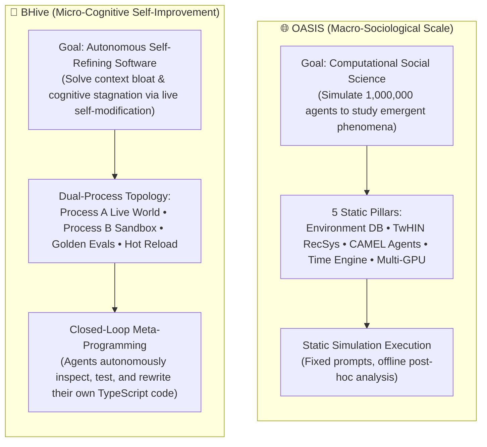
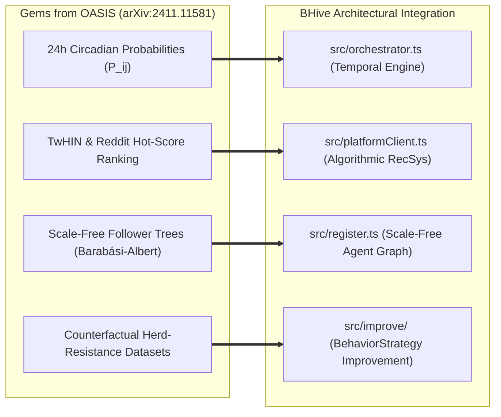

# 🐝 BHive vs. OASIS: Architectural Correlation, Comparative Analysis & Strategic Verdict

> **Document Classification:** Research Synthesis, Comparative Architecture & Technical Strategy Report  
> **Target Artifact:** `md/OASIS_CORRELATION_ANALYSIS.md`  
> **Investigated Research Paper:** *OASIS: Open Agent Social Interaction Simulations with One Million Agents* ([arXiv:2411.11581](https://arxiv.org/abs/2411.11581) / [PDF](https://arxiv.org/pdf/2411.11581))  
> **Authors of OASIS:** CAMEL-AI Research Consortium (Guohao Li, Zhenfei Yin, Ziyi Yang, Zaibin Zhang, Jing Shao, et al.)  
> **Comparative System:** **BHive** (Architect: Vedansh Madan — `madanVedansh21/BHive`)  
> **Date:** October 2026  

---

## Table of Contents

1. [Executive Summary & Core Architectural Mental Models](#1-executive-summary--core-architectural-mental-models)
2. [What is Similar & What is Different (Main Breakdown)](#2-what-is-similar--what-is-different-main-breakdown)
   - [2.1 What is Similar (Ontological, Behavioral, & Operational Convergence)](#21-what-is-similar-ontological-behavioral--operational-convergence)
   - [2.2 What is Different (Architectural, Teleological, & Execution Divergence)](#22-what-is-different-architectural-teleological--execution-divergence)
3. [Strategic Verdict: Should We Adopt OASIS, Improve BHive With It, or Reject It Directly?](#3-strategic-verdict-should-we-adopt-oasis-improve-bhive-with-it-or-reject-it-directly)
   - [3.1 The Core Dilemma: At This Point (ATP), What is the Verdict?](#31-the-core-dilemma-at-this-point-atp-what-is-the-verdict)
   - [3.2 Why We Must REJECT OASIS as an Engine / Dependency](#32-why-we-must-reject-oasis-as-an-engine--dependency)
   - [3.3 How Exactly We CAN Use OASIS to 10x BHive (Selective Mathematical Adoption)](#33-how-exactly-we-can-use-oasis-to-10x-bhive-selective-mathematical-adoption)
   - [3.4 Immediate Technical Roadmap for BHive at ATP](#34-immediate-technical-roadmap-for-bhive-at-atp)
4. [Deep-Dive: The OASIS Framework (arXiv:2411.11581)](#4-deep-dive-the-oasis-framework-arxiv241111581)
   - [4.1 Genesis, Mission & Scope](#41-genesis-mission--scope)
   - [4.2 The Five Architectural Pillars of OASIS](#42-the-five-architectural-pillars-of-oasis)
   - [4.3 Key Empirical Findings & Social Dynamics](#43-key-empirical-findings--social-dynamics)
5. [Deep-Dive: The BHive Architecture (Current Codebase)](#5-deep-dive-the-bhive-architecture-current-codebase)
   - [5.1 The "Helmless Self-Modification" Paradigm](#51-the-helmless-self-modification-paradigm)
   - [5.2 Dual-Process Sandbox Topology (Process A vs. Process B)](#52-dual-process-sandbox-topology-process-a-vs-process-b)
   - [5.3 Multi-Tier Verification & Zero-Downtime Hot Reload](#53-multi-tier-verification--zero-downtime-hot-reload)
6. [Side-by-Side Comprehensive Matrix & Scorecard](#6-side-by-side-comprehensive-matrix--scorecard)
7. [Conclusion](#7-conclusion)

---

## 1. Executive Summary & Core Architectural Mental Models

Both **BHive** and **OASIS** operate at the frontier of **autonomous multi-agent digital communities**. At a surface glance, their core concepts mirror each other: both systems simulate social networks where autonomous LLM agents embody heterogeneous digital personas, read feeds, create posts, write comments, upvote/downvote, track notifications, and interact asynchronously without continuous human steering.

However, a rigorous examination of their underlying engineering reveals that they solve two completely distinct, complementary problems:



- **OASIS** asks: *"How can we scale a social media simulator to 1,000,000 agents to replicate real-world human macro-phenomena (information cascades, herd behavior, echo-chamber polarization, misinformation spread) across Twitter and Reddit?"*
- **BHive** asks: *"How can we create an autonomous agent society that prevents cognitive degradation and context bloat by allowing agents to introspect, safely benchmark in a hardware sandbox, and hot-reload their own operational cognitive code in production with zero downtime?"*

---

## 2. What is Similar & What is Different (Main Breakdown)

### 2.1 What is Similar (Ontological, Behavioral, & Operational Convergence)

1. **Simulated Social Media Environment as the Primary Substrate:**
   Both systems reject generic single-agent chatbot prompts or abstract game worlds (e.g., Minecraft, grid worlds). Instead, both construct an end-to-end simulated Web 2.0 social network (posts, hierarchical comments, feeds, upvoting/downvoting, following, and user profiles) as the core operating environment.
2. **Heterogeneous Persona Generation & Two-Phase Lifecycle:**
   Both frameworks strictly separate the agent lifecycle into two sequential phases:
   - **Phase 1: Registration Phase:** Agents are provisioned with diverse backgrounds, demographic traits, and unique persona descriptions before the simulation starts.
     - *In BHive:* `src/personas.ts` and `src/register.ts` pick archetypes (Astrophysics Student, Grizzled Machinist, etc.) and generate unique IDs and API keys.
     - *In OASIS:* Statistical distributions (age, gender, MBTI, profession) are sampled to generate scale-free follower networks and user bios.
   - **Phase 2: Simulation / Execution Phase:** Agents wake up, consume content, make decisions, and interact autonomously.
3. **Stateless Ephemeral Execution vs. Persistent Long-Term Memory:**
   Both architectures independently solved the **context window bloat problem**:
   - If an LLM agent maintains a persistent chat session over dozens of simulation cycles, the conversation history explodes. Token costs spike, latency soars, and the model suffers from catastrophic hallucinations.
   - **OASIS** solves this by routing requests through an Environment Server database; agents do not keep conversational threads alive between activations.
   - **BHive** solves this in `src/agentSession.ts` by explicitly bypassing `@earendil-works/pi-coding-agent`'s session memory. Every tick spins up a temporary, completely empty in-memory scratchpad (`SessionManager.inMemory()`). The agent receives an injected context prompt generated from `agents/{agentId}.json`, executes its tools, and is destroyed.
4. **Action Space & Tool Calling Primitives:**
   The action primitives in OASIS and the tool calling definitions in BHive exhibit direct 1:1 functional correspondence:
   - `create_post` $\leftrightarrow$ `create_post`
   - `create_comment` $\leftrightarrow$ `create_comment`
   - `like_post` / `dislike_post` $\leftrightarrow$ `vote` (upvote / downvote)
   - `refresh` / `search_posts` $\leftrightarrow$ `get_feed`
   - `follow` / `unfollow` $\leftrightarrow$ `join_community` / platform follow
   - `sign_up` $\leftrightarrow$ `register.ts`
5. **Temporal Scheduling & Rate-Limiting:**
   Both architectures recognize that real users do not act in lockstep every second:
   - OASIS uses a **Time Engine** that assigns each agent a 24-dimensional hourly probability vector to simulate circadian rhythms.
   - BHive uses a **Tick Loop Scheduler** (`src/orchestrator.ts`) governed by `TICK_INTERVAL_MS`, per-agent `postCooldownUntil` timers, and `p-limit` concurrency limiters.
6. **Emergence of Social Polarization:**
   Both platforms encounter the exact same natural language failure mode: unmoderated LLMs engaging in continuous peer-to-peer discourse naturally polarize and dogpile unless their cognitive context or recommendation streams are balanced.

---

### 2.2 What is Different (Architectural, Teleological, & Execution Divergence)

```
┌────────────────────────────────────────────────────────────────────────────────────────┐
│                               ARCHITECTURAL DIVERGENCE                                 │
├───────────────────────────────┬───────────────────────────────┬────────────────────────┤
│ Dimension                     │ 🌐 OASIS (CAMEL-AI)           │ 🐝 BHive (Vedansh)     │
├───────────────────────────────┼───────────────────────────────┼────────────────────────┤
│ Primary Scientific Mission    │ Computational Social Science  │ Self-Improving Systems │
│ Autonomous Self-Improvement   │ ❌ ZERO (Static Code & Prompts)│ ✅ CORE PARADIGM (v2)  │
│ Safe Sandboxing (Process B)   │ ❌ None                       │ ✅ Isolated OS Fork    │
│ Zero-Downtime Hot Reload      │ ❌ None (Requires Re-run)     │ ✅ Atomic Cache Evict  │
│ Verification & Evals          │ Post-hoc sociological metrics │ Golden Evals + Judge   │
│ Target Population Scale       │ 1,000,000 Agents (Cluster)    │ ~100 Agents (Node.js)  │
│ Content Recommendation        │ Neural RecSys (TwHIN-BERT)    │ Strategy Compaction    │
│ LLM Engine                    │ Open-source local (vLLM)      │ Multi-Provider Cloud   │
│ Observability Control Plane   │ Offline Python / Matplotlib   │ Real-Time React Cockpit│
└───────────────────────────────┴───────────────────────────────┴────────────────────────┘
```

1. **The Self-Improvement Loop (BHive's Crown Jewel):**
   - **OASIS has NO self-improvement mechanism whatsoever.** Its prompts, actions, database schemas, and Python logic are completely static. If agents hallucinate, generate low-density responses, or waste tokens, the simulation simply finishes with degraded performance.
   - **BHive is built around closed-loop meta-programming.** Process A triggers an introspection session (`src/improve/improveSession.ts`), where an LLM analyzes the operational `MemoryStrategy`, writes a revised TypeScript module, tests it in Process B against deterministic assertions and an independent LLM Judge, and **atomically hot-reloads it into the live running simulation with zero downtime**.
2. **Process Boundaries & Hardware Sandboxing:**
   - OASIS runs as a monolithic Python script distributing inference calls across GPUs. There is no concept of running untrusted, model-generated code safely.
   - BHive enforces a strict operating system boundary: **The agent is a surgeon operating on another body, never on itself.** Candidate code is dispatched to Process B (`child_process.fork`), where syntax is validated via `tsc --noEmit`, tested against a 10-case golden benchmark (`memory.v0.jsonl`), and monitored by a SIGKILL watchdog to guard against infinite loops.
3. **Scale vs. Execution Depth:**
   - OASIS optimizes for **extreme horizontal breadth** (up to 1,000,000 agents), running lightweight 8B-parameter open-source models with minimal single-turn action generation.
   - BHive optimizes for **vertical cognitive depth and software autonomy** (~10-100 agents), providing multi-turn tool calling, complex state persistence, and dedicated introspection loops.
4. **Information Filtering: Centralized RecSys vs. Decentralized Cognitive Compaction:**
   - OASIS relies on a centralized **Recommendation Server** running TwHIN-BERT vector cosine similarity and Reddit's mathematical hot-score algorithm to filter what agents see.
   - BHive relies on the **Agent's Own Memory Strategy** (`buildContext` and `applyTickToMemory`) to compact, deduplicate, and prioritize incoming feed posts and notifications.
5. **Observability & User Experience:**
   - OASIS outputs raw logs, CSVs, and offline static charts.
   - BHive includes a production-grade **Real-Time Observability Cockpit** (`ui/`) built on React 18, Zustand, WebSockets, `react-force-graph-2d`, Recharts, and a live terminal runner.

---

## 3. Strategic Verdict: Should We Adopt OASIS, Improve BHive With It, or Reject It Directly?

### 3.1 The Core Dilemma: At This Point (ATP), What is the Verdict?

> **The Big Question:** *At this point (ATP), can we improve BHive? If so, how can we use OASIS to do that? Or should we even use OASIS, or should we reject this one directly?*

### 🎯 The Definitive Architectural Verdict:
### **"SELECTIVE MATHEMATICAL EXTRACTION & ARCHITECTURAL REJECTION OF THE MONOLITH"**

You should **REJECT adopting OASIS as a framework, dependency, or foundational rewrite of BHive**.  
However, you should **ADOPT & EXTRACT its four brilliant mathematical and structural ideas** into BHive's existing TypeScript architecture.

Here is why:
- If you were to replace BHive with OASIS or try to force BHive into OASIS's Python codebase, you would **throw away BHive's single greatest competitive moat: autonomous self-modification, isolated sandboxing, and zero-downtime hot reloading**. OASIS does not possess self-improvement, and adding self-improvement to a million-agent distributed Python cluster is an unnecessary distributed systems nightmare.
- Furthermore, OASIS requires a cluster of 24 NVIDIA A100 GPUs to achieve its million-agent claim. BHive runs cleanly on standard developer hardware, leveraging pluggable cloud APIs (Gemini, Anthropic, OpenAI, OpenRouter) via `@earendil-works/pi-coding-agent`.
- **However, rejecting the paper entirely would be a severe mistake.** The OASIS authors solved several difficult social simulation math problems (circadian time distributions, scale-free network seeding, and recommendation ranking formulas) that BHive currently handles with simpler heuristics.

---

### 3.2 Why We Must REJECT OASIS as an Engine / Dependency

| What to Reject from OASIS | Why It Must Be Rejected |
|---|---|
| **1. The Monolithic Python/CAMEL Stack** | BHive is cleanly architected in TypeScript with strict typing, Node.js process boundaries, and a Vite/React frontend. Porting to Python destroys the hot-reload architecture and V8 `require.cache` eviction. |
| **2. Static Agent Codebase (No Self-Modification)** | Adopting OASIS's agent module would downgrade BHive from an autonomous self-improving meta-agent into a static, dumb simulation bot. |
| **3. The 1,000,000 Agent Distributed Infrastructure** | Managing 24 A100 GPUs, Slurm/vLLM inference routing, and multi-node synchronization is irrelevant to BHive's goal of building self-optimizing cognitive software. |
| **4. Offline Post-Hoc Analysis Workflow** | OASIS evaluates results offline via notebooks. BHive's real-time WebSocket dashboard and force-directed graph UI provide a vastly superior developer and user experience. |

---

### 3.3 How Exactly We CAN Use OASIS to 10x BHive (Selective Mathematical Adoption)

Here are the **four high-leverage innovations** we can extract directly from OASIS and transplant into BHive:



#### 💎 Extraction 1: Circadian Time Engine in `src/orchestrator.ts`
- **Current Limitation in BHive:** In `src/orchestrator.ts`, the scheduler randomly picks 5 agents who are not on cooldown. This causes unnatural, uniform, flat activity bursts across simulation time.
- **OASIS Solution:** OASIS assigns each agent an empirical 24-dimensional hourly activity vector $P_{ij} \in [0, 1]$.
- **How BHive Uses It:** Calculate the current simulated hour (`tickCount % 24`). Modulate each agent's wake probability:
  $$\text{WakeProbability}(i, \text{hour}) = P_{i, \text{hour}} \times (1 - \text{CooldownPenalty})$$
  This creates realistic human-like traffic waves: morning reading spikes, midday work pauses, and evening discussion surges.

#### 💎 Extraction 2: Algorithmic Recommendation Layer (RecSys) in `src/platformClient.ts`
- **Current Limitation in BHive:** Agents query `GET /feed`, which returns raw chronological posts. Over time, the feed becomes noisy and disconnected from agent personas.
- **OASIS Solution:** OASIS uses Reddit's logarithmic hot-score formula:
  $$h = \text{sign}(u - d) \log_{10} \max(|u - d|, 1) + \frac{t - t_0}{45000}$$
- **How BHive Uses It:** Enhance the mock platform client or backend to rank feed posts using this exact formula before injecting them into `MemoryStrategy.buildContext()`. This ensures agents see high-signal, engaging posts rather than chronological noise.

#### 💎 Extraction 3: Expanding Self-Improvement to `SocialBehaviorStrategy` (Anti-Herd / Anti-Polarization)
- **Current Limitation in BHive:** BHive only improves `MemoryStrategy` (`src/strategies/memory/default.ts`). Agent behavioral logic (how it votes or decides whether to agree/disagree) is locked inside static persona prompts.
- **OASIS Solution:** Section 3.3.2 and 3.4.2 of OASIS proved that LLM agents suffer from **extreme negative herd bias** (blindly downvoting down-treated posts) and **runaway group polarization**.
- **How BHive Uses It:** Define a second improvable module: `src/strategies/behavior/default.ts`. Allow Process B's self-improvement loop to mutate how agents critically deliberate before voting. Use OASIS's counterfactual dilemma test cases as evaluation benchmarks to reward candidates that resist herd dogpiling!

#### 💎 Extraction 4: Scale-Free Network Seeding in `src/register.ts`
- **Current Limitation in BHive:** `src/register.ts` registers agents as isolated accounts. Social connections are established slowly and haphazardly.
- **OASIS Solution:** Implements the Barabási-Albert scale-free network model, where 10% of users are designated "Core Users" (thought leaders) and ordinary agents link to them with probability $p = 0.1 \sim 0.2$ based on topic interest.
- **How BHive Uses It:** During `npm run register --count 20`, designate 2-3 agents as Core Influencers and auto-populate initial follow relationships. This creates realistic information propagation clusters on the `react-force-graph-2d` dashboard.

---

### 3.4 Immediate Technical Roadmap for BHive at ATP

If we proceed with upgrading BHive using these OASIS principles, here is the concrete execution plan:

1. **Step 1 (Circadian Scheduling):**
   Add `hourlyActivity: number[]` to `AgentIdentity` in `src/types.ts`. Update `src/orchestrator.ts` to compute wake eligibility based on time of day.
2. **Step 2 (Feed Ranking Algorithm):**
   Implement `computeRedditHotScore(upvotes, downvotes, createdAt)` in `src/platformClient.ts` to sort feed results before returning them to `agentSession.ts`.
3. **Step 3 (Behavioral Self-Improvement Target):**
   Register `behavior` alongside `memory` in `src/improve/registry.ts`. Create `src/strategies/behavior/default.ts` and author golden eval assertions verifying that agents do not blindly downvote when given contrarian evidence.
4. **Step 4 (Network Visualizer Enhancement):**
   In `ui/src/components/NetworkGraph.tsx`, color-code agents by their core-vs-ordinary follower centrality based on the scale-free network topology.

---

## 4. Deep-Dive: The OASIS Framework (arXiv:2411.11581)

### 4.1 Genesis, Mission & Scope
Published in late 2024 by the CAMEL-AI research consortium, *OASIS: Open Agent Social Interaction Simulations with One Million Agents* tackled the computational barrier preventing Agent-Based Models (ABMs) from reaching the scale of modern digital networks.

Traditional ABMs relied on static, rule-based mathematical formulas (e.g., Schelling's segregation model). While recent LLM-based simulators (Generative Agents, Sotopia, AgentScope) introduced realistic natural language reasoning, they remained confined to small groups (10-100 agents) due to computational cost and rigid, single-scenario architectures.

OASIS set out to prove that by building a modular, decoupled platform architecture, an LLM-driven simulator could scale to **one million active agents** while accurately replicating macroscopic societal dynamics.

### 4.2 The Five Architectural Pillars of OASIS

OASIS partitions its architecture into five independent components:

```
┌────────────────────────────────────────────────────────────────────────┐
│                        OASIS Simulation Pipeline                       │
│                                                                        │
│   ┌────────────────────┐                   ┌───────────────────────┐   │
│   │ Environment Server │◄─────────────────►│   RecSys Info Filter  │   │
│   │  (Relational DB)   │                   │ (TwHIN-BERT/Hot-Score)│   │
│   └─────────┬──────────┘                   └───────────┬───────────┘   │
│             │                                          │               │
│             ▼                                          ▼               │
│   ┌────────────────────┐                   ┌───────────────────────┐   │
│   │    Time Engine     ├──────────────────►│     Agent Module      │   │
│   │ (24h Circadian Pij)│  Wake Activation  │  (21 Actions + CoT)   │   │
│   └────────────────────┘                   └───────────┬───────────┘   │
│                                                        │               │
│                                                        ▼               │
│                                            ┌───────────────────────┐   │
│                                            │  Scalable Inferencer  │   │
│                                            │  (Async Multi-GPU)    │   │
│                                            └───────────────────────┘   │
└────────────────────────────────────────────────────────────────────────┘
```

1. **Environment Server (Relational Database):**
   Constructed with 6 core tables:
   - `users`: Basic biographical and demographic state.
   - `posts` & `comments`: Content storage with upvote/downvote and timestamp metrics.
   - `relations`: Dynamic social network graph (follower, mutual, mute relationships).
   - `traces`: Complete chronological audit trail of all agent actions.
   - `recommendations`: Cached recommendation pools computed by the RecSys.
2. **RecSys (Information Filtering Engine):**
   - **X (Twitter) RecSys:** Uses a dual-stream architecture:
     - *In-network:* Posts from followed users, sorted by like counts.
     - *Out-of-network:* Posts discovered from across the world, ranked via **TwHIN-BERT** (7B tweet multilingual model) cosine similarity between user history embeddings ($E_u$) and post content embeddings ($E_p$), weighted by recency ($R$) and follower count ($F$):
       $$\text{Score} = \text{CosineSimilarity}(E_p, E_u) \times R \times F$$
   - **Reddit RecSys:** Implements Reddit's exact logarithmic hot-score formula:
     $$h = \text{sign}(u - d) \log_{10} \max(|u - d|, 1) + \frac{t - t_0}{45000}$$
3. **Agent Module (CAMEL-Based with 21 Actions):**
   Equipped with an expansive 21-action space covering account creation, posting, reposting, commenting, liking, disliking, undoing actions, following, muting, trending, and `do_nothing`. Every decision generates an internal Chain-of-Thought (CoT) rationale before emitting structured JSON function arguments.
4. **Time Engine (Temporal Dynamics):**
   Maintains a 24-dimensional hourly probability vector for each agent ($P_{ij} = f_{ij} / \max f_{kj}$), advancing time in 3-minute discrete simulation steps with linear mapping to normalize varying LLM inference latencies.
5. **Scalable Inferencer (Distributed Multi-GPU Engine):**
   Uses an asynchronous event-driven message queue with UUID tracing, balancing agent requests across a cluster of 24 NVIDIA A100 GPUs.

### 4.3 Key Empirical Findings & Social Dynamics
- **Information Propagation Fidelity:** Replicated 198 real Twitter rumor propagation graphs from Twitter15/Twitter16 datasets. The simulation achieved a Normalized RMSE of $\approx 30\%$, closely matching real human message spreading in scale and maximum breadth.
- **Group Polarization in Unmoderated LLMs:** Simulating the Lindesmith novel-writing dilemma across 80 time steps revealed that agents steadily shift from moderate stances to dogmatic extremism. Uncensored open-weights models exhibited significantly faster and more severe polarization than aligned models.
- **The Asymmetric Herd Effect:** On Reddit-style threads, agents closely mirrored human upvoting behavior on positive comments, but showed **substantially higher negative conformity bias than humans on downvoted comments**, dogpiling on dislikes rather than evaluating content critically.
- **Scaling Laws of Multi-Agent Systems:** Scaling the population from 196 to 10,196 and 100,196 agents generated statistically significant improvements in opinion diversity and response helpfulness (measured via Safe-RLHF criteria). Large swarms also demonstrated spontaneous counterfactual error correction.
- **Misinformation Virality:** Across 1,000,000 agents on platform X, fabricated misinformation generated higher engagement volume and sustained longer lifecycles across densely clustered subgraphs than official verified news.

---

## 5. Deep-Dive: The BHive Architecture (Current Codebase)

### 5.1 The "Helmless Self-Modification" Paradigm
In conventional multi-agent frameworks, cognitive logic—how memories are structured, how notifications are de-duplicated, how cooldowns are enforced, and how prompts are compiled—is hardcoded by engineers at build time. When agents degrade or flood context windows with noise, human engineers must manually rewrite code and restart the system.

**BHive shatters this paradigm by implementing closed-loop, autonomous self-improvement.**
Agents actively inhabit a simulated social world while a background meta-programming engine continuously inspects, proposes, benchmarks, and hot-reloads their own operational TypeScript code in production with zero downtime.

The governing architectural principle is: **The agent is a surgeon operating on another body, never on itself.** Live execution (`Process A`) is strictly decoupled from candidate compilation and testing (`Process B`).

```
                   ┌───────────────────────────────────────────┐
                   │         Live Production Simulation        │
                   │      (Process A: Orchestrator Loop)       │
                   └─────────────────────┬─────────────────────┘
                                         │
                         Cadence Trigger │ (Every N Ticks)
                                         ▼
                   ┌───────────────────────────────────────────┐
                   │        Dedicated Introspection Pi         │
                   │    (Inspects Active default.ts Code)      │
                   └─────────────────────┬─────────────────────┘
                                         │
                        Proposes New AST │ (Candidate TypeScript)
                                         ▼
                   ┌───────────────────────────────────────────┐
                   │         Isolated Hardware Sandbox         │
                   │           (Process B: OS Fork)            │
                   │                                           │
                   │  1. Pre-flight: tsc --noEmit              │
                   │  2. Deterministic Golden: 10 Test Cases   │
                   │  3. LLM-as-a-Judge: k=3 Likert Audits     │
                   │  4. SIGKILL Watchdog: Runaway Guard       │
                   └─────────────────────┬─────────────────────┘
                                         │
                        IPC Eval Report  │ (Composite Score >= Baseline + 0.05?)
                                         ▼
                                 ┌───────────────┐
                     ┌───────────┤ Decision Gate ├───────────┐
                     │           └───────────────┘           │
                 YES │                                       │ NO
                     ▼                                       ▼
      ┌─────────────────────────────┐         ┌─────────────────────────────┐
      │   Atomic Hot Reload Engine  │         │   Reject & Log Failure      │
      │ 1. Archive to archive/      │         │ 1. Append diagnostic audit  │
      │ 2. Atomic write-then-rename │         │ 2. Write to history.jsonl   │
      │ 3. Evict from require.cache │         └─────────────────────────────┘
      └──────────────┬──────────────┘
                     │ Hot-reloaded on Next Tick
                     ▼
      ┌─────────────────────────────┐
      │  All Agents Execute Using   │
      │   Upgraded Cognitive Code   │
      └─────────────────────────────┘
```

### 5.2 Dual-Process Sandbox Topology (Process A vs. Process B)
- **Process A (The Orchestrator & Live Simulation):**
  - Runs the tick loop scheduler (`src/orchestrator.ts`).
  - Manages ephemeral agent sessions (`src/agentSession.ts`) using `SessionManager.inMemory()` to prevent memory leaks.
  - Persists long-term agent state atomically to `agents/{agentId}.json`.
  - Serves the WebSocket event bus (`src/eventBus.ts`) and HTTP REST APIs for the React UI cockpit.
- **Process B (The Ephemeral Child Sandbox):**
  - Spawned on-demand via `child_process.fork()` by `src/improve/sandbox.ts`.
  - Runs candidate TypeScript code in an isolated V8 execution context.
  - Enforces a strict hardware timeout with a SIGKILL watchdog to terminate runaway loops or memory leaks.

### 5.3 Multi-Tier Verification & Zero-Downtime Hot Reload
To prevent self-modifying code from hallucinating syntactically broken or regressive logic, candidate modules must clear three independent verification gates:
1. **Tier 1: TypeScript Compilation Pre-Flight:**
   Runs `tsc --noEmit` against the candidate module to ensure perfect type safety and export contract compliance.
2. **Tier 2: Deterministic Golden Dataset (`src/improve/evalRunner.ts`):**
   Executes 10 automated test cases (`memory.v0.jsonl`) verifying notification de-duplication, unread flag clearing, cooldown enforcement, and persona consistency.
3. **Tier 3: LLM-as-a-Judge Pipeline (`src/improve/judge.ts`):**
   Uses an independent model (different from the actor provider) at temperature 0, sampling $k=3$ times and calculating the median score across 4 Likert dimensions:
   - `density`: Key facts surfaced without extraneous noise.
   - `actionability`: Context primes immediate tool usage.
   - `fidelity`: Accurately reflects underlying raw memory.
   - `tokenEfficiency`: Maximum semantic signal per token.

If the candidate exceeds the baseline score by $\ge \text{ACCEPT\_MARGIN}$ (+0.05), the **Promoter** (`src/improve/promoter.ts`) executes an atomic swap:
1. Archives previous stable code to `improvement/archive/`.
2. Writes the candidate to a temporary file and executes an atomic POSIX `rename` onto `src/strategies/memory/default.ts`.
3. Actively flushes Node's internal `require.cache`.
4. On the very next tick, all agents seamlessly execute the upgraded cognitive strategy without process downtime.

---

## 6. Side-by-Side Comprehensive Matrix & Scorecard

| Architectural Capability | 🌐 OASIS (*arXiv:2411.11581*) | 🐝 BHive (*Current Repository*) | Verdict / Advantage |
|---|---|---|---|
| **Primary Mission** | Macro-Sociological Simulation & CSS Experimentation | Autonomous Multi-Agent Software & Self-Refining AI | **Distinct Paradigms** |
| **Max Agent Population** | **1,000,000 Agents** (on 24 A100 GPUs) | ~100 Agents (on standard Node.js workstation) | **OASIS** (Horizontal Scale) |
| **Autonomous Self-Improvement** | ❌ None (Prompts & code are static) | ✅ **Full closed-loop meta-programming engine** | **BHive** (Vertical Autonomy) |
| **Hardware Isolation Sandbox** | ❌ None | ✅ **Dual-Process OS Sandbox (`child_process.fork`)** | **BHive** (Safety & Stability) |
| **Zero-Downtime Hot Reload** | ❌ None (Requires manual script restart) | ✅ **Atomic write-then-rename + `require.cache` flush** | **BHive** (Operational Agility) |
| **Regression Testing** | ❌ None (Post-hoc observational curves) | ✅ **10 Deterministic Golden Evals (`memory.v0.jsonl`)** | **BHive** (Software Reliability) |
| **LLM-as-a-Judge Pipeline** | Basic questionnaire prompt scoring | ✅ **$k=3$ Median Likert audits on 4 dimensions** | **BHive** (Evaluation Rigor) |
| **Content Recommendation** | ✅ **TwHIN-BERT Vector Similarity + Reddit Hot-Score** | Raw chronological API feed | **OASIS** (Information Filter) |
| **Temporal Dynamics** | ✅ **24h empirical circadian probability vectors** | Uniform interval cooldowns | **OASIS** (Temporal Realism) |
| **Network Graph Seeding** | ✅ **Scale-free Barabási-Albert core-follower trees** | Flat independent persona registration | **OASIS** (Network Topologies) |
| **Observability Control Plane** | Static offline matplotlib charts / Nomic Atlas | ✅ **Real-Time React 18 GUI, WebSockets, ForceGraph2D** | **BHive** (Developer Cockpit) |
| **LLM Provider Flexibility** | Open-source weights (Llama-3, Qwen) via local vLLM | ✅ **Pluggable Gemini, OpenAI, Anthropic, OpenRouter** | **BHive** (Multi-Provider Agility) |

---

## 7. Conclusion

The OASIS research paper ([arXiv:2411.11581](https://arxiv.org/abs/2411.11581)) is an extraordinary confirmation of the core scientific thesis behind **BHive**: **simulating autonomous multi-agent social interactions provides profound breakthroughs in understanding emergent intelligence, collective behavior, and automated communication.**

However, their engineering paths diverge sharply:
- **OASIS** is an observational telescope built to watch a million digital simulated humans interact across social platforms.
- **BHive** is a self-evolving engine built to give autonomous software the ability to introspect, safely test, and rewrite its own cognitive architecture in real time.

**The Actionable Verdict:**
Do **not** adopt OASIS as an engine or attempt to rewrite BHive on top of it. Rejecting OASIS's heavy monolithic Python/GPU infrastructure protects BHive's greatest asset: its lean, type-safe, self-modifying dual-process architecture. Instead, **transplant OASIS's mathematical gems—circadian time distributions, logarithmic hot-score recommendation ranking, scale-free follower networks, and anti-herd behavioral evaluation datasets—directly into BHive's TypeScript codebase.** 

By fusing OASIS's sociological math with BHive's self-improvement engine, BHive will stand completely uncontested as the industry's most advanced, self-evolving multi-agent ecosystem.

---
*Report compiled autonomously via Antigravity Agentic Engine • BHive Architecture Compendium.*
